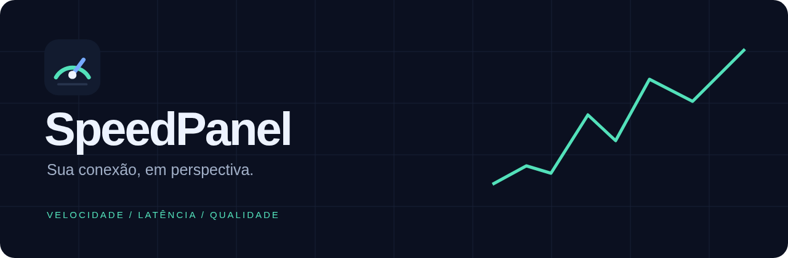

# SpeedPanel

## Relatórios selecionáveis e filtro de falhas

Na visão geral, **Ocultar testes com falha** filtra somente status de erro; testes
concluídos com alertas de regra continuam aparecendo. A preferência fica salva no navegador
e também se aplica às análises e ao CSV. Nenhum registro é apagado.

**Relatório PDF** e **Exportar Excel** abrem uma caixa para escolher Velocidade,
Uptime e/ou Análises. É obrigatório escolher ao menos uma seção. A opção de ocultar
falhas no documento pode ser ajustada independentemente da tela. Ela afeta as medições
de velocidade e suas análises; incidentes de uptime continuam incluídos.

Todas as seções usam o mesmo período selecionado. O serviço de medição filtra velocidade
e análises; uptime inclui todos os monitores, inclusive arquivados com histórico. O PDF
contém capa com filtros, definições, gráficos, mapa por horário e tabelas completas das
seções escolhidas. O Excel acrescenta abas de escopo/metodologia e tabelas tipadas por tema.
Respostas de uptime são agregadas por hora, com média, máximo e contagem de lentidão;
incidentes e lacunas são listados individualmente, sem corte de 10.000 registros.
O histórico anterior ao cadastro/à retenção aparece como sem dados. Configurações e metas
são as vigentes no momento da geração, sem prometer reproduzir configurações antigas.

API: `GET /api/report.pdf?sections=speed,uptime,analysis&hide_failed=1` (ou `.xlsx`),
com os mesmos filtros `from`, `to` e `provider` da visão geral. Por compatibilidade,
a ausência de `sections` mantém a exportação somente de velocidade.
`python test_report_sections.py` verifica as sete combinações, filtros, datas, incidentes,
segurança de fórmulas e tipos numéricos/datas. O teste de navegador verifica a seleção,
download dos dois formatos, filtro persistente e layout em celular.

## Uptime e análises

As abas **Uptime** e **Análises** complementam os testes de velocidade.

Em Uptime, cadastre HTTP/HTTPS (código esperado, redirecionamentos e certificado TLS validado),
TCP (abertura de porta) ou ping ICMP. Configure intervalo de 10 a 86.400 segundos,
tempo limite de 1 a 30 segundos (menor que o intervalo), 1 a 10 falhas consecutivas
para confirmar queda e limite de resposta lenta. Até 100 monitores e 8 verificações
simultâneas; os probes têm prazo total e são independentes da fila de velocidade.
Ping usa iputils-ping na imagem. Destinos que bloqueiam ICMP devem usar HTTP ou TCP.

O teste manual é diagnóstico e não altera o histórico. Pausar, retomar e manutenção
até uma data estão disponíveis. O botão Manutenção 1h inicia uma janela imediatamente;
a configuração permite agendar início e término futuros. Arquivar preserva os dados e encerra a coleta.
Alterações de configuração interrompem a continuidade anterior e iniciam uma nova observação.

A disponibilidade é calculada por duração observada, não por quantidade de respostas.
Após o limite de falhas, as falhas consecutivas pendentes passam a contar como queda
desde a primeira. Períodos pendentes, sem coleta, pausados ou em manutenção são excluídos
do denominador; a cobertura informa a fração efetivamente observada do período completo.
Uma amostra expira após 1,5 intervalo + timeout, evitando prolongar o último estado por
um desligamento. Há tolerância de amostragem, não precisão de segundos entre verificações.
Dados anteriores ao cadastro/à retenção também aparecem sem cobertura.

Incidentes e durações são recortados pelo filtro de 24h, 7 ou 30 dias. Somente uma
resposta disponível observada após a queda confirma recuperação e entra no tempo médio
de recuperação. Uma lacuna ou manutenção encerra a observação sem presumir recuperação.
O gráfico e a tabela de resposta agrupam médias, máximos e respostas lentas por hora.
As marcações da linha do tempo priorizam qualquer queda dentro de cada bloco.

Em Análises, os filtros de serviço e período são os mesmos da visão geral. Configure
download/upload contratados e percentual mínimo esperado; zero desativa a comparação.
As metas são comuns à conexão e recalculam a comparação histórica, sem alterar resultados
ou regras dos serviços. O percentual abaixo da meta refere-se a medições, não a tempo
contínuo de lentidão. Mediana, P95 interpolado, mínimos e máximos excluem falhas e dados
ausentes. O mapa agrupa por dia da semana/hora no fuso configurado. A correlação compara
o estado de cada monitor no início real dos novos testes. Resultados antigos sem esse
campo usam a entrada na fila e são indicados como horários aproximados; associação não implica causalidade.
Os agregados incluem todo o intervalo, sem o limite de 10.000 registros da tabela principal.

A retenção geral vale também para uptime. O monitoramento depende deste servidor:
para detectar indisponibilidade do próprio servidor, use uma sonda em outro equipamento
ou local. Não há envio de alertas externos nesta versão.

`python test_monitoring.py` verifica autenticação, CSRF, validação, falhas consecutivas,
lacunas, cálculos por duração, manutenção, arquivamento, percentis, metas, filtros,
correlação, agregados acima de 10.000 registros e probes reais HTTP/TCP locais.
`python test_ui.py` executa o fluxo de navegador em uma base temporária (requer Edge
e Playwright no Windows) e salva capturas de desktop/celular em `qa/`.

Painel privado para executar e comparar medições de internet a partir do servidor.

## Executar com Docker

```sh
export ADMIN_PASSWORD='defina-uma-senha-forte'
export SESSION_SECRET="$(openssl rand -hex 32)"
docker compose up -d --build
```

Abra `http://localhost:8095`. Os resultados ficam no volume persistente em `/data`.
Não publique o painel na internet sem HTTPS e controles de acesso.

## Configuração

Em **Serviços e regras**, configure cada serviço, execute um teste manual e ative os testes automáticos. Cada serviço aceita múltiplas expressões cron separadas por ponto e vírgula. O fuso inicial é America/Sao_Paulo; pode ser alterado em Configurações. Os agendamentos começam desativados para revisão pelo administrador.

Defina limites de download, upload, latência, jitter e perda. Zero desativa o limite. As violações ficam destacadas no histórico; este aplicativo não envia notificações externas. Métricas não fornecidas pelo serviço aparecem como indisponíveis, sem estimativas.

Os testes são executados em sequência, com fila persistente. Um teste que atravessa um horário não impede a criação dos próximos trabalhos. Trabalhos já enfileirados preservam a configuração existente na criação. Horários ocorridos com o servidor desligado não são recuperados. Testes interrompidos por reinício aparecem como falhas.

## Integrações

**Ookla:** usa o executável oficial Speedtest CLI 1.2.0, com suporte a ID de servidor e interface do contêiner. A execução usa os parâmetros de aceite da licença e GDPR do CLI. Termos: https://www.speedtest.net/about/terms. O binário Docker incluído é para x86_64.

**Fast.com:** abre o site em Chromium e coleta download, upload e latência. Jitter e perda não são fornecidos por esse adaptador.

**Brasil Banda Larga:** abre o site em Chromium, inicia a medição e lê o resultado salvo pelo próprio site. Coleta download, upload, latência, jitter e perda quando disponibilizados. Automação de sites depende de sua estrutura e pode precisar de ajustes se ela mudar.

**Site personalizado:** informe URL, seletores CSS para clicar em ordem, seletor de conclusão e seletores de métricas. Exemplo: cliques `["#iniciar"]`, conclusão `#resultado.concluido`, métricas `{"download":"#download","upload":"#upload","ping":"#ping"}`. A conclusão deve ficar visível apenas depois de terminar o teste. Valores precisam estar em Mbps, ms e %. Não é executado JavaScript fornecido pelo usuário.

**API JSON:** importa medições existentes de um endpoint GET. Não transforma um endpoint genérico em um teste de velocidade. Exemplo de caminhos: `{"download":"result.download","upload":"result.upload","ping":"result.ping"}`. Valores precisam estar em Mbps, ms e %. Para uma API que dispara testes com autenticação ou fluxo próprio, é necessário desenvolver um adaptador específico.

Cada novo serviço exige uma integração compatível; cadastrar apenas a URL não garante que o site possa ser automatizado. Não há promessa de suporte universal.

## Histórico e armazenamento

Filtros por serviço e intervalo; gráficos de download, upload, latência, jitter e perda; tabela paginada; exportação CSV, relatório PDF e Excel (.xlsx). A tela mostra até 10.000 registros por filtro; os arquivos incluem todo o intervalo, sem esse corte. O PDF contém resumo, comparativo por serviço, gráficos de download/upload, histórico e detalhes das falhas/regras. O Excel contém as abas Resumo e Medições, com datas e números tipados, filtros e gráfico comparativo. Ambos respeitam os campos de período e serviço do painel, usam o fuso configurado e são fotografias dos resultados no momento da geração. Métricas ausentes ficam vazias no Excel e marcadas com hífen no PDF.

Banco SQLite no volume Docker persistente montado em /data. Retenção inicial de 365 dias, configurável. Dados brutos e configuração usada ficam armazenados junto aos resultados.

Os horários da tela usam o fuso configurado; os filtros de data usam o fuso do navegador. CSV em UTC. Métricas agregadas excluem falhas e trabalhos pendentes. Todos os testes medem a conexão do servidor, não a conexão do dispositivo que abre o painel.

## Acesso e manutenção

A senha inicial fica na variável `ADMIN_PASSWORD` (mapeada de `SERVICE_PASSWORD_ADMIN` no Coolify) e é usada apenas para criar o acesso inicial. Depois, altere a senha pelo painel. A variável `SESSION_SECRET` (mapeada de `SERVICE_PASSWORD_64_SECRET` no Coolify) assina as sessões e deve ser preservada.

O serviço pode ser construído pelo Docker Compose ou publicado no Coolify. Preserve as variáveis secretas e faça backup do volume antes de migrar.

Para backup consistente com o serviço rodando, use a API de backup do SQLite ou pare o serviço durante a cópia do volume. Um arquivo SQLite copiado durante escrita pode ficar inconsistente.

O Compose fornecido vincula o painel a localhost na porta 8095. Para acesso público, configure domínio e HTTPS no proxy do Coolify antes de publicar.

## Verificação

`python test_app.py` verifica autenticação, CSRF, validação de agendamentos, regras, persistência, preservação do histórico ao excluir serviço e escape de fórmulas no CSV. A validação real de cada integração deve executar uma medição no servidor e conferir o histórico.

## Diagnóstico de medições

A coluna **Detalhes / regras** distingue falhas de execução e resultados que não atendem aos limites configurados.

- `ConfigurationError` / `Cannot open socket` (Ookla): verifique conectividade, DNS e acesso aos servidores de medição. Teste sem ID de servidor ou interface fixa.
- `ERR_INTERNET_DISCONNECTED`: o navegador do teste não tem conectividade; confira a rede Docker e a rota de saída.
- `ERR_NAME_NOT_RESOLVED`: falha de resolução DNS no container.
- `Tempo limite`: o serviço não terminou no prazo; confirme a disponibilidade antes de aumentar o timeout.
- `Revisar regras`: a medição terminou, mas alguma métrica está fora dos limites ou não está disponível nesse adaptador.

O endpoint `/health` verifica a aplicação e o worker; não comprova acesso à internet.
Uma rede Docker removida deve ser restaurada antes de recriar o container pela configuração do deployment. Preserve o volume de dados.
Erros históricos permanecem como registro; uma nova medição bem-sucedida não altera o histórico.

## Identidade visual

Logo e favicon: [`static/logo.svg`](static/logo.svg). Banner: [`static/banner.svg`](static/banner.svg).
Os arquivos vetoriais compartilham a paleta escura, verde menta e azul da interface.

Para rodar os testes de relatórios, instale também as dependências de desenvolvimento: `pip install -r requirements-dev.txt`.


## Gráficos interativos

Os gráficos de velocidade e uptime oferecem detalhes ao passar o mouse ou tocar,
fixação de valores por clique, legenda para mostrar/ocultar séries e visualização
ampliada. Use os botões +/−, arraste um intervalo horizontal ou escolha um recorte
rápido relativo à última amostra. As setas deslocam o período; Restaurar volta ao
intervalo completo. O zoom dos gráficos de velocidade é sincronizado entre as métricas
e é preservado durante a atualização automática.

Por teclado, ←/→ percorrem amostras, Home/End escolhem os extremos, +/− ajustam o zoom,
0 restaura o período e Esc libera os detalhes fixados. O resumo textual e o histórico
continuam disponíveis. O zoom altera somente a visualização, sem mudar os filtros,
os dados armazenados ou o período dos relatórios. Séries de uptime preservam lacunas;
dados densos usam amostragem visual que mantém extremos, sem alterar os valores usados
nos detalhes e nas estatísticas. Não há dependência de CDN para desenhar os gráficos.

`python test_charts.py` verifica zoom, arraste, seleção de séries, teclado, toque,
ampliação, preservação de picos e de lacunas com 4.000 medições em um servidor temporário
(requer Edge e Playwright no Windows).
